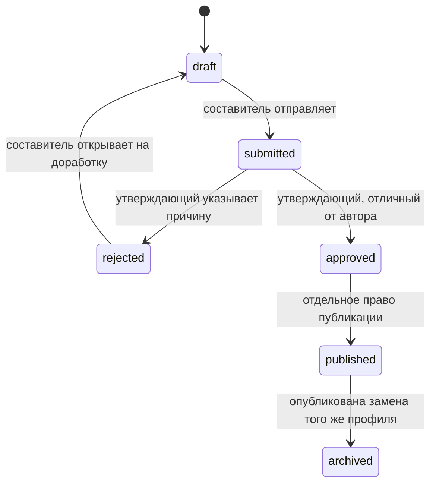

# Этап 6: версии, согласование и публикация

Основание: паспорт З7 основного ТЗ v0.9. DOCX, идентификаторы требований и очереди сохранены. Реализованы VER-001/002, DATA-003, REQ-005/006, ENG-010/011/014, UX-006/008/009 и публикационная часть PLN-003. Разрешение на реализацию этого этапа дано пользователем; код оформляется от `8zellorr8`.

## Состояния и ревизии

`schedule_drafts` остаётся таблицей версий, совместимой с редактором и генератором. Новые поля: `version_number`, `workflow_revision`, `parent_id`; номер уникален внутри контекста «область + учебный год + вид данных». Миграция нумерует существующие версии по времени создания/ID. Счётчик контекста выделяет номера транзакционно, не повышая ревизию исходных учебных данных.

`revision` меняет содержимое; `workflow_revision` меняет состояние. Команда передаёт оба ожидаемых значения. Возврат и повторная подача при той же ревизии содержимого не разрешают повторно применить старую команду: ревизия состояния и ID подачи уже другие.

Редактор изменяет только `draft`. Новая копия любой доступной версии получает собственные ID событий/серий, номер, родителя, ревизию содержимого 1 и состояние `draft`; утверждение и публикация не копируются. Старая публикация сохраняется до успешной публикации замены.

## Подача и решение

Составитель выбирает группы, кабинеты и один семестр. Сервер передаёт все события версии независимому валидатору, заново строит подтверждённые входы и проверяет полноту выбранных групп. Успешная подача фиксирует входы, события, выбор и отчёт в `version_submissions`; редактор после этого закрыт для правок.

Утверждающий принимает конкретные ID подачи, версии и её ревизии. При утверждении повторяются проверка входов и независимая проверка; изменение источника, календаря, кабинета, условий или событий требует новой подачи. Отклонение требует непустой причины и допускает возврат неподтверждённых входов автору.

**Предположение Q-007:** утверждающий отличается от создателя версии, авторов сохранённых редакций и отправителя текущей подачи. Добавление автору роли утверждающего не снимает запрет. Утверждение и публикация — разные права; для второго требуется `can_publish` у назначения `approver` в нужной области.

Решение хранит действие, ревизию, автора, время и комментарий. `version_transitions` фиксирует успешные переходы и их ревизии состояния. Отчёт генератора или чужой версии не заменяет эти записи.

## Защищённая публикация VER-001

1. Проверить текущие серверные права; получить транзакционную общую блокировку PostgreSQL `5816001`, затем блокировки Scope → Context → Version → User/RoleGrant.
2. Для уже выполненного ключа операции сравнить автора и полное тело команды: вернуть прежнюю квитанцию либо `PUBLICATION_KEY_REUSED`.
3. Проверить ожидаемые ревизии, состояние `approved`, точный ID утверждения и соответствие текущей подаче.
4. Повторно построить входы и проверить сохранённые события независимым валидатором; отклонить устаревшую подачу и неполный/недопустимый план.
5. Проверить общие ресурсы по всем действующим опубликованным снимкам, без фильтра области доступа. Старый снимок заменяемого профиля исключается целиком.
6. Записать неизменяемую публикацию, результат ключа операции, переходы и аудит; переключить указатель профиля и перевести прежнюю версию в архив в той же транзакции.

Сбой любого шага откатывает всю операцию. Занятая блокировка проверяется не более трёх раз с паузами по 50 мс; исчерпание даёт контролируемый `409 PUBLICATION_BUSY`. Внутренние ошибки не выдаются за успешную публикацию.

Клиент хранит ожидающий подтверждения ключ и тело команды отдельно для пользователя/области/версии. При потере связи, 5xx или занятости повторяет их без изменений, в том числе после обновления страницы. Определённый отказ проверки требует нового отчёта готовности. Ответ старой операции остаётся прежним после появления более новой публикации и не переключает указатель обратно.

## Профиль и общая занятость

**Предположение реализации:** профиль — контекст, семестр и точное множество полных групп. Новый снимок заменяет профиль целиком. Частичное пересечение групп с другим действующим профилем того же контекста/семестра блокируется как `PUBLICATION_PROFILE_OVERLAP`; разделение и слияние действующих снимков автоматически не выполняются.

**Предположение области:** один Scope представляет колледж; его подразделения используют подтверждённые канонические UUID ресурсов. Система не объединяет одноимённые ресурсы и людей разных справочников. Для одинаковой физической аудитории, заведённой под разными UUID, требуется уточнить справочник; равенство названий не доказывает общность ресурса.

Проверка сравнивает UUID преподавателя, полной группы и эксклюзивного кабинета для активных событий. Интервалы переводятся из подтверждённых учебных поясов в UTC и сравниваются как `[начало, конец)`, включая пересечение разных гражданских дат. Неоднозначное/несуществующее время и переход часов внутри занятия блокируются для уточнения.

Индекс содержит отсортированные начала и накопленные максимумы окончаний: после подготовки занятости наличие пересечения проверяется двоичным поиском. Попарный случайный эталон контролирует результат. Ограничения стенда: 200 000 событий действующего реестра и 200 записей диагностики; превышение не разрешает публикацию. Чужая служебная диагностика не раскрывается: отказ содержит только ресурс и событие запрашивающей стороны.

Подтверждённые ручные интервалы занятости также проверяет независимый валидатор. Занятость вне зарегистрированных публикаций и подтверждённых условий сохраняет явную пометку непроверенности по Q-007; её отсутствие не превращается в выдуманные свободные интервалы.

## Неизменяемость и чтение

`publications` хранит номер/ревизию, область и её название, год, семестр, группы, пояс, входы, события, утверждение и свежий отчёт. `publication_heads` хранит единственный текущий указатель профиля; `publication_operations` — квитанцию повтора. Триггеры БД запрещают UPDATE/DELETE снимков, подач, решений, переходов и результатов ключей. Изменения исходников не переписывают публикацию.

Читательские операции выполняются в `REPEATABLE READ READ ONLY`: список текущих снимков, признак текущего и содержимое соответствуют одной точке чтения, даже при конкурентной замене. GET по ID читает выбранный неизменяемый снимок, а не подставляет другой текущий.

| Действие | admin | scheduler | approver | teacher | student |
|---|---|---|---|---|---|
| Версии, история и отчёты | — | да | да | — | — |
| Изменить черновик / создать копию | — | да | — | — | — |
| Подать / открыть отклонённый | — | да | — | — | — |
| Утвердить / отклонить | — | — | да, Q-007 | — | — |
| Опубликовать | — | — | отдельный `can_publish` | — | — |
| Опубликованный просмотр | область | область | область | свои подтверждённые связи | своя подтверждённая группа |

Ограничение читателя применяется до фильтра и пагинации. Его список публикаций, группы и варианты фильтров тоже ограничены разрешёнными событиями. Ответ не содержит исходную книгу, координаты ячеек, условия расчёта, ID назначений или служебные комментарии. Следующий отказ закрытого чтения очищает прежние карточки. Видны номер, область, дата занятия/публикации, учебный пояс и режим демо.

## HTTP и интерфейс

| Контракт | Результат |
|---|---|
| GET `/api/scopes/{scope}/schedule-versions` | Разрешённый список версий |
| GET `/api/schedule-versions/{id}` | Точная версия, подача, решение и история |
| POST `/api/schedule-versions/{id}/submit` | Подача с двумя ожидаемыми ревизиями и профилем |
| POST `/api/schedule-versions/{id}/approve` или `/reject` | Решение по конкретному ID подачи |
| POST `/api/schedule-versions/{id}/reopen` | Отклонённая версия возвращена в черновик |
| POST `/api/schedule-versions/{id}/fork` | Новая версия, HTTP 201 |
| GET `/api/readiness?schedule_version_id=…&expected_revision=…` | Публикационная готовность утверждённой версии, связанный токен и диагностика; данные не исправляет |
| POST `/api/schedule-versions/{id}/publish` | Квитанция публикации или контролируемый отказ |
| GET `/api/scopes/{scope}/publications` | Действующие разрешённые снимки |
| GET `/api/publications/{id}` | Разрешённые события; даты, группа/преподаватель/кабинет, пагинация |

Изменения имеют строгий контракт, лимит тела 128 КиБ, CSRF/Origin и существующий локальный профиль безопасности. Публикация требует двух ожидаемых ревизий, ID утверждения, токена готовности и UUID ключа операции. Query `scope_id` не даёт полномочий. Старый защитный POST `/api/drafts/{id}/submit` теперь является алиасом реальной подачи с новым контрактом; временный 501-маршрут утверждения заменён реальным.

В KK добавлены экраны «Келісу және жариялау» и «Жарияланған кесте». Переход из редактора открывает именно выбранную версию. Отказы сохраняют ввод; новая публикация обновляет статусы всего списка. Обязательные названия шести состояний проверяются TypeScript. Наблюдения, введённые названия и исходные книги сохраняют своё содержание; демо-подписи применяются существующим словарём отображения.

XLSX использует выбранный опубликованный ID на следующем отдельном этапе. Уведомления, сравнение, мастер нового года, регистрация, RU/EN и «Сегодня» сохраняют свои очереди. Регламент эксплуатации и репетиция мамы выполняются отдельно от автоматических проверок этого модуля.

Архитектурное решение: дополнение к [существующему журналу решений](stage-1-decisions.md). Испытания: [отчёт этапа](stage-6-publication-test-report.md).
